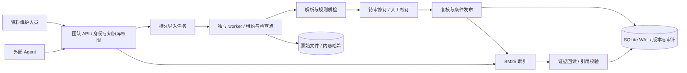
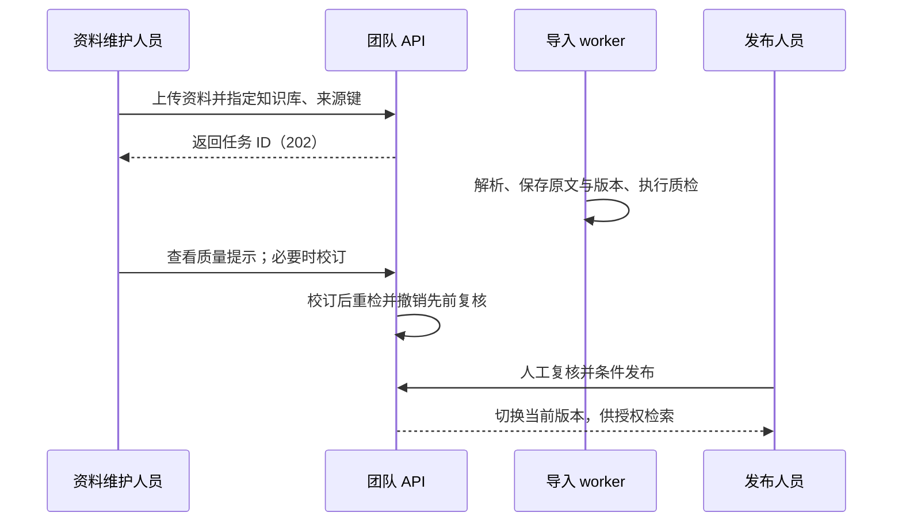

<div align="center">

# 知证 · AI 数据中台

**让 Agent 使用的数据有来源、有版本、可检查、可追溯。**

Python 3.13 · FastAPI · SQLite WAL · 异步导入 · 人工复核 · BM25

[项目能力](#项目能力) · [系统架构](#系统架构) · [快速开始](#快速开始) · [数据与安全](#数据与安全) · [使用边界](#使用边界)

</div>

知证面向内部知识维护和 Agent 应用，将文档、PDF 和结构化文件组织为可检索的资料：上传后生成持久任务，保留原始文件与文本版本，执行规则质检，经人工复核后发布。Agent 按知识库授权检索证据，并在使用前核验来源版本和内容哈希。

项目同时提供**团队服务**与**本地工作台**。团队服务提供受控导入、质检、校订、发布和取证 API；本地工作台用于资料管理、清洗预览与 Wiki 维护。两者使用独立数据目录和权限边界。

> 当前定位为**单机内部团队实现和工程实践项目**。CSV/JSON 以文档原文保存并检索；不存在数据库连接器、结构化数仓或增量同步。真实部署仍需对安全、容量、备份恢复与监控进行现场验收。


截图来自真实本机 API 与独立 worker 的隔离验收，使用虚构资料和生成账户。改造范围、307 项 Python 与 68 项 Node 回归、浏览器和恢复验证见[本地交付验收](docs/TEAM_WORKBENCH_ACCEPTANCE.md)。

## 为什么做这个项目

| 场景 | 常见问题 | 知证的处理方式 |
| --- | --- | --- |
| 多格式资料接入 | 文档分散、解析失败难排查 | 上传并创建持久任务，保存原文件、解析进度与失败状态 |
| 数据质量 | 错字、异常字符和表格结构问题混入知识来源 | 版本绑定规则质检，记录异常并由人工复核 |
| 来源更新 | 新旧规则混用，历史引用难核对 | 资料创建新版本，保留旧版；发布时按预期版本切换 |
| Agent 使用数据 | 模型不知道证据能否访问、是否已过期 | 库级授权、原文回读及引用版本与哈希校验 |

## 项目能力

| 模块 | 已实现能力 |
| --- | --- |
| 数据接入 | 支持 PDF、Markdown、TXT、DOCX、CSV、JSON；团队上传需目标知识库授权，原文件按内容哈希保存，复用前校验已有文件 |
| 异步处理 | 导入使用持久任务与独立 worker；支持进度查询、取消、失败重试、租约与 fencing 检查 |
| 数据质检 | 检查短正文、异常字符和重复行；CSV 检查表头、字段数量及字段超限；JSON 检查语法与对象内重复键；PDF 标记空页、低文本与缺字 |
| 人工校订 | 对待审页面按文本哈希进行条件更新；保留抽取原文、重新检查质量并撤销已有审核状态 |
| 版本与发布 | 由 publisher 显式复核并条件发布；新修订切换后旧版仍可追溯，未发布内容不进入默认检索 |
| 知识与证据 | 团队服务提供 BM25 检索、原文回读和引用校验；本地工作台支持 Wiki 草稿、修订和来源失效提示 |
| 权限与审计 | 团队服务提供用户会话、受限 Bearer 令牌、知识库角色授权和关键操作审计 |
| 运维支持 | 备份恢复校验数据库、清单完整性与文件哈希；提供 worker 心跳接口、只读部署预检、孤儿上传候选报告和 systemd 示例 |

质检是可解释的规则提示，**不保证资料真实、完整或合规**。CSV/JSON 校验基础格式后仍需人工确认业务字段和语义。CSV 单字段仍受 Python 运行时长度限制；超限时会返回可识别的失败原因，不会调整进程全局配置。

## 系统架构



团队服务将解析任务和查询 API 分开：worker 处理文件和页面，发布步骤负责切换当前版本；Agent 只读取已发布、当前有权限的证据。原始文件与数据库需要共同纳入备份。

### 数据处理流程



`202` 表示已接收任务，不代表解析或发布成功。旧版本不会自动执行新质检规则；重新处理已有来源需使用更新流程并指定当前修订。完整 API 示例见[团队服务手册](docs/TEAM_SERVICE.md)。

## 技术栈

| 层次 | 主要技术 |
| --- | --- |
| 服务与接口 | Python 3.13、FastAPI、Pydantic、HTTPX |
| 任务与解析 | 独立 Python worker、任务租约、pypdf、标准库 CSV/JSON/DOCX 解析 |
| 存储与检索 | SQLite WAL、内容哈希文件存储、稀疏 BM25 |
| 本地界面 | 原生 HTML、CSS、JavaScript；无需前端构建 |
| 验证 | pytest、Node.js 内置测试器 |

## 快速开始

以下步骤用于**本机演示**。需要 Python 3.13 和 Node.js（仅运行前端测试时需要）。

```bash
git clone https://github.com/kayaduster607-jpg/zhiwiki-data-platform.git
cd zhiwiki-data-platform
```

### 1. 准备 Python 环境

```bash
python -m venv .venv
```

在 Windows PowerShell 中运行 `.\.venv\Scripts\Activate.ps1`，或在 Linux/macOS 中运行 `source .venv/bin/activate`。随后安装服务和 PDF 解析依赖：

```bash
python -m pip install -r requirements.txt -r requirements-parser.txt
```

### 2. 启动团队服务

首次使用时创建管理员，密码交互输入、至少 12 个字符；项目不提供默认密码：

```bash
python -B -m zhiwiki.service --config config.team.example.json bootstrap admin
```

分别在两个已激活虚拟环境的终端运行 API 和导入 worker：

```bash
# 终端 A：非 Secure Cookie 仅供回环地址本机演示
python -B -m zhiwiki.service --config config.team.example.json serve --port 8872 --local-http

# 终端 B：解析和导入任务
python -B -m zhiwiki.service --config config.team.example.json worker
```

打开 [http://127.0.0.1:8872](http://127.0.0.1:8872) 登录。团队网页提供资料与版本、真实文件导入、可恢复任务、逐页校订、复核发布、原文取证、账号授权、Agent 令牌及运行审计。管理操作使用真实 `/v1` API，不依赖演示数据或浏览器持久存储。

使用步骤见[团队网页手册](docs/TEAM_WORKBENCH.md)，产品范围与验收条件见[团队工作台 PRD](docs/PRD_TEAM_WORKBENCH_V1.md)。HTTP 接入见[团队服务手册](docs/TEAM_SERVICE.md)及[质量与审核说明](docs/TEAM_DATA_QUALITY.md)。正式环境仍需独立完成部署验收。

### 3. 体验本地工作台

如需体验资料管理、清洗预览与 Wiki，可另开终端：

```bash
python -B -m zhiwiki --config config.example.json seed
python -B -m zhiwiki --config config.example.json serve --port 8875
```

访问 [http://127.0.0.1:8875](http://127.0.0.1:8875)。`seed` 会写入项目自带的**虚构演示资料**。本地工作台默认使用 `data/`，团队服务默认使用 `data-team/`；不要让两个入口同时写入同一数据目录。

## 数据与安全

- 团队访问依靠用户会话或限定范围的 Bearer 令牌，并按知识库授权控制检索、导入和发布；浏览器会话的写操作需要 CSRF 校验。
- PDF 原文和文件保留来源；Markdown、TXT、DOCX、CSV、JSON 最大 2 MiB，文本 PDF 最大 200 MiB、2,000 页。实际容量受配置和机器资源限制。
- 待审页校订使用文本哈希防止覆盖并发修改；CSV/JSON 校订需通过格式校验。复核及条件发布不能替代事实核查。
- 原始文件、版本和审计不会自动删除。备份应使用项目提供的快照流程，并验证数据库、文件和索引的恢复结果；不要只复制运行中的 SQLite 主文件。
- 配置采用显式 JSON。原始资料、数据库、密码和令牌不应提交到代码仓库；项目不读取 `.env`。

## 测试与部署

```bash
python -m pip install -r requirements-dev.txt
python -B -m pytest -q -p no:cacheprovider
node --test tests/*.cjs
```

内部部署前可使用[部署预检](docs/DEPLOYMENT_PREFLIGHT.md)检查配置与目录。预检不会替代目标服务器上的 TLS 验证、权限审查、容量测试、备份恢复演练或外部监控。`deploy/systemd/` 中的文件是示例，需要按实际环境适配，不会自动安装服务。

部署时只运行一个团队 API 实例，并单独运行导入 worker。正常访问应使用受控的 HTTPS 反向代理，保持 Secure Cookie 和明确的主机名；不要将本地工作台暴露到企业网络。详见[团队部署与 Agent 接入](docs/TEAM_SERVICE.md)。

## 项目结构

```text
zhiwiki/
├── service/        # 团队 API、授权、任务、质检、发布与运维
├── web/            # 本地工作台
├── ingest.py       # 本地文档、CSV、JSON 解析
├── data_quality.py # 可解释的文档质量规则
├── store.py        # 本地资料、版本和 Wiki 存储
└── retrieval.py    # 文本切分与检索能力
tests/              # 单元、接口和团队服务测试
docs/               # 设计、接口、使用与部署说明
deploy/systemd/     # 单机服务管理示例
examples/           # 明确标记的虚构演示资料
```

## 使用边界

- **数据范围**：尚无数据库/对象存储连接器、字段映射、行级权限、增量同步或可配置的业务规则；CSV/JSON 当前按文档处理。
- **解析范围**：文本 PDF 支持页面提取；扫描件 OCR、复杂公式及版式还原不在当前能力内。
- **部署范围**：单工作区、单 API 实例和 SQLite 单机部署；没有多机高可用、多租户 SaaS 或 SSO。
- **团队界面**：团队页面侧重基础登录与检索；导入、质检结果读取、校订和发布主要通过 API 操作。
- **上线条件**：TLS、备份隔离与恢复、持续监控、容量和实际权限配置需要在目标环境实测；本地测试不能代表生产 SLA。

## 文档

| 主题 | 文档 |
| --- | --- |
| 团队导入、质检、复核和发布 | [团队资料质量与审核](docs/TEAM_DATA_QUALITY.md) · [结构化文件接入](docs/TEAM_STRUCTURED_SOURCES.md) |
| 团队服务与 Agent 接入 | [部署与接入手册](docs/TEAM_SERVICE.md) · [API 契约](docs/RAG_API_CONTRACT.md) |
| 本地工作台 | [数据接入与质量工作台](docs/DATA_WORKSPACE.md) · 演示说明 |
| 运维准备 | [部署预检](docs/DEPLOYMENT_PREFLIGHT.md) · [孤儿上传候选报告](docs/ORPHAN_UPLOAD_REPORT.md) |
