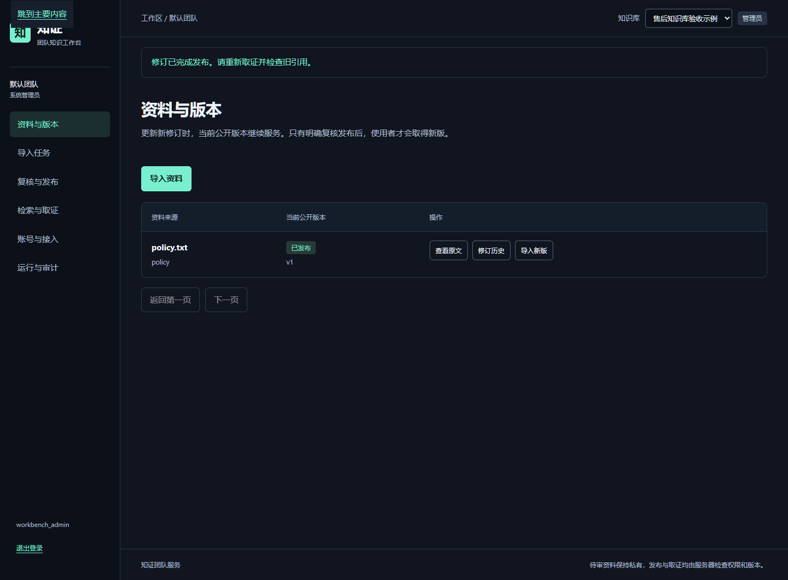
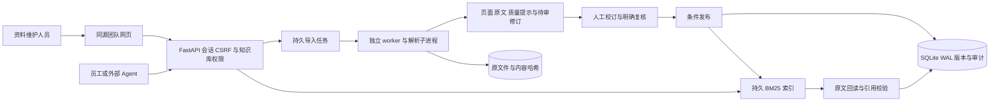
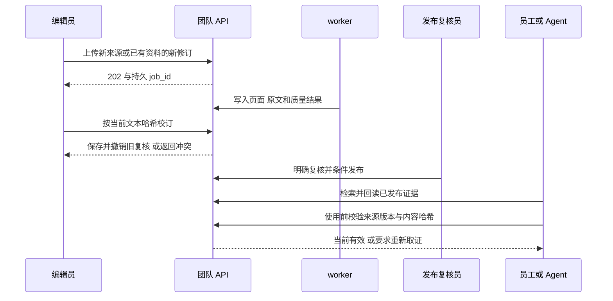

<div align="center">

# 知证 · 团队知识工作台

**让新资料经过复核再发布，让 Agent 取得有来源且版本可核验的证据。**

Python 3.13 · FastAPI · SQLite WAL · 独立 worker · BM25 · 原生网页

[演示视频](docs/assets/zhizheng-workbench-demo.mp4) · [本机运行](#本机运行) · [产品需求](docs/PRD_TEAM_WORKBENCH_V1.md) · [交付验收](docs/TEAM_WORKBENCH_ACCEPTANCE.md)

</div>

知证面向内部资料维护和 Agent 应用，把分散文件组织成**可导入、可校订、可复核发布、可回读原文**的知识来源。编辑员跟进持久任务，发布复核员确认新修订；员工与 Agent 只取得当前有权限的已发布证据。资料更新后，旧引用需要重新校验。

团队网页与 API 已连接真实工作流。项目定位为**单工作区、单机内部团队实现**，正式上线仍需在目标环境完成安全、容量、监控和恢复验收。

## 先看一次完整操作

[](docs/assets/zhizheng-workbench-demo.mp4)

**[观看 MP4 演示](docs/assets/zhizheng-workbench-demo.mp4)**：建库授权 → 文件导入 → 任务跟进 → 校订冲突 → 复核发布 → 原文取证 → 新版使旧引用失效 → 令牌撤销 → 只读账号边界。

视频录制于真实本机 API 与独立 worker，使用虚构售后资料和临时生成的账号，含中文步骤说明，无配音。令牌明文在录屏中遮挡，演示令牌随后撤销。录制和复现说明见[演示说明](docs/DEMO_VIDEO.md)。

## 解决什么问题

| 工作中的问题 | 知证的处理方式 |
| --- | --- |
| 文件接收成功后，不知道是否处理完成 | 上传返回持久任务 ID，进度、失败、取消与重试都能继续查询 |
| 新稿未经确认就进入知识来源 | 原稿与待审修订分开，校订撤销旧复核，publisher 明确发布 |
| 两个编辑窗口互相覆盖 | 按文本哈希和公开版本执行条件写入，冲突时保留输入 |
| 政策更新后还在引用旧内容 | 取证保留来源修订与内容哈希，再使用前验证当前有效性 |
| Agent 拥有过宽的数据能力 | 知识库授权叠加受限只读 scopes，管理内容不向 Bearer 令牌开放 |

## 已实现的工作流

| 模块 | 页面和服务行为 |
| --- | --- |
| 资料与版本 | 授权目录、稳定来源键、公开版本、修订历史与原文件下载 |
| 文件接入 | PDF、Markdown、TXT、DOCX、CSV、JSON；保留原始文件并按哈希核验 |
| 导入任务 | 独立 worker、持久进度、失败重试、取消、租约与 fencing；刷新可重新进入任务 |
| 质检和校订 | 格式与字符等规则提示、逐页原文、条件校订、原始抽取留存 |
| 复核发布 | 待审队列、复核说明、角色检查、幂等与当前版本条件；旧稿在更新期间继续服务 |
| 证据使用 | BM25 检索、原文回读、引用版本和哈希校验；明确语义支持尚未核验 |
| 团队接入 | 用户、知识库、成员角色、本人令牌创建与撤销；只读目录隐藏未公开来源 |
| 运行维护 | 真实健康和 worker 心跳、操作审计、备份恢复校验、只读部署预检及 systemd 示例 |

CSV/JSON 经过基础格式检查后仍按文档原文存储和检索，不表示已经建立结构化数仓。规则质检提供可解释提示，不能自动证明资料真实、完整或合规。

## 架构与数据流



API 和导入 worker 分开运行，长文件处理不会占用检索调用的执行槽。发布过程负责切换当前公开修订与索引；待审内容不会进入普通检索。数据库、原始文件和索引共同构成恢复所需的数据。



## 本机运行

准备 Python 3.13。团队网页无需 Node.js 构建；Node 仅用于前端回归，Playwright 和 FFmpeg 仅用于可选的浏览器验收与录屏。

### 安装与创建管理员

```powershell
git clone https://github.com/kayaduster607-jpg/zhiwiki-data-platform.git
cd zhiwiki-data-platform
python -m venv .venv
.\.venv\Scripts\Activate.ps1
python -m pip install -r requirements.txt -r requirements-parser.txt
python -B -m zhiwiki.service --config config.team.example.json bootstrap admin
```

管理员密码交互输入，至少 12 字符。系统没有默认密码；录像中的账号是隔离验证时生成的临时账号。

### 启动 API 和 worker

在两个已激活虚拟环境的终端分别运行：

```powershell
# 终端 A：仅用于回环地址的本机 HTTP 演示
python -B -m zhiwiki.service --config config.team.example.json serve --port 8872 --local-http
```

```powershell
# 终端 B：独立处理导入任务
python -B -m zhiwiki.service --config config.team.example.json worker
```

打开 [http://127.0.0.1:8872](http://127.0.0.1:8872) 登录。在“账号与接入”创建知识库、用户并分配库角色，然后从“资料与版本”导入资料。任务完成后核对原文，由 publisher 复核并发布，再到“检索与取证”取得证据。

上传成功只表示已接收。没有 worker 时任务不会自动解析；没有明确复核发布时，普通使用者不会取得新稿。完整步骤见[团队网页手册](docs/TEAM_WORKBENCH.md)。

### 可选的本地工作台

原单人工作台保留资料管理、清洗预览与 Wiki 维护，使用独立本地入口：

```powershell
python -B -m zhiwiki --config config.example.json seed
python -B -m zhiwiki --config config.example.json serve --port 8875
```

访问 [http://127.0.0.1:8875](http://127.0.0.1:8875)。seed 写入项目自带的虚构资料。本地工作台默认 data/，团队服务默认 data-team/；两个入口不能共同写同一目录。本地入口不作为企业网络的鉴权服务。

## 权限和证据边界

| 身份 | 使用范围 |
| --- | --- |
| reader | 已发布授权资料、检索与原文证据 |
| editor | 加上资料导入、任务跟进和待审校订 |
| publisher | 加上明确复核与条件发布 |
| 知识库 admin | 对应知识库中的高级权限，不等同全局管理员 |
| 全局管理员 | 用户、知识库、成员授权、运行状态和审计 |
| Agent 令牌 | 本人当前库权限与 retrieve/read/validate/download scopes 的交集 |

浏览器使用 HttpOnly 会话与 CSRF；Agent 使用受限 Bearer。新令牌只显示一次，离开页面清除，列表不返回明文。浏览器不把业务正文或凭证写入 localStorage/sessionStorage。资料正文按文本节点显示，静态资源白名单配合同源 CSP 和私有缓存策略。

**引用校验通过表示版本、内容和访问条件通过检查。** semantic_support 为 not_checked，仍需核对原文是否支持结论。团队取证不调用模型；本地工作台的模型能力不能等同于团队服务已经提供的功能。

## 数据与正式部署

| 数据 | 存储与维护 |
| --- | --- |
| 账号、授权、任务、修订与审计 | 团队数据目录中的 SQLite 数据库 |
| 原始文件 | uploads/ 内容寻址存储，复用前检查实际字节哈希 |
| 检索索引 | indexes/ 持久索引，与当前知识库 generation 对应 |
| 取证凭据 | 限期有效的服务端记录；资料或授权变化后需要重新校验 |

正式部署只运行一个团队 API 实例，并独立管理 worker。使用受控 HTTPS 反向代理、Secure Cookie、明确的 Host 与受限服务账户；不要使用 --local-http。配置为显式 JSON，系统不读取 .env。

先运行[只读部署预检](docs/DEPLOYMENT_PREFLIGHT.md)，再在目标机器完成 TLS、代理头、权限、进程重启、磁盘、外部监控、备份定时与隔离恢复验收。systemd 文件是需适配的示例。备份必须覆盖数据库和原文件等恢复资产，不能只复制运行中的 SQLite 主文件。

文本资料上限 2 MiB；文本 PDF 默认上限 200 MiB、2,000 页，实际受配置和机器限制。CSV 单字段受 Python 运行时限制，超限会返回可识别错误；不会为一次请求修改全局长度设置。资料、原文件和审计不会自动删除，保留规则需要业务与运维明确。

扫描件 OCR、复杂公式及原始版式还原不在当前解析范围。

## 验证与复现

```powershell
python -m pip install -r requirements-dev.txt
python -B -m pytest -q -p no:cacheprovider
node --test tests/*.cjs
```

本轮本机验证：**307 项 Python、68 项 Node 回归通过**。使用真实 API、独立 worker 和 Chrome 走通新建、更新、刷新恢复、412 冲突、旧引用失效、令牌撤销与 reader 限制；390px 页面无整体横向溢出。将生成数据备份到隔离目录再恢复，核对原文件、公开 v2 与成员授权。

这些结果不外推为线上容量或 SLA。版本、范围与待现场门禁见[验收对照](docs/TEAM_WORKBENCH_ACCEPTANCE.md)和[机器可读摘要](docs/TEAM_WORKBENCH_VERIFICATION.json)。浏览器验收及录屏可通过 scripts/verify_team_workbench.py 复现，说明见[演示说明](docs/DEMO_VIDEO.md)。

## 项目结构

```text
zhiwiki/
├── service/
│   ├── console/             # 同源团队网页和按任务拆分的模块
│   ├── console_queries.py   # 带权限与分页的控制台读模型
│   ├── routes_console.py    # 列表接口
│   ├── jobs.py              # 持久任务 校订与条件发布
│   └── worker.py            # 独立监督与解析进程
├── web/                     # 独立的本地工作台
├── store.py                 # 原文 版本与 Wiki
└── retrieval.py             # 切分与检索
docs/                        # PRD 使用手册 验收与演示视频
scripts/                     # 评测 预检与真实浏览器验证
tests/                       # 单元 接口 权限与状态回归
deploy/systemd/              # 单机进程管理示例
examples/                    # 明确标记的虚构资料
```

## 本版范围与文档

当前不提供结构化数仓、数据库连接器、增量同步、多租户计费、单点登录或多机高可用；角色管理也不等于强制双人审批。资料事实核查、数据敏感分级、保留期、真实容量与恢复时间需要试点确认。后续扩展由这些需求和测量结果决定。

- [完整 PRD 与 R01—R12 验收要求](docs/PRD_TEAM_WORKBENCH_V1.md)
- [Word 版 PRD（9 页，带分级导航）](docs/PRD_TEAM_WORKBENCH_V1.docx)
- [团队网页操作与维护](docs/TEAM_WORKBENCH.md)
- [团队 API 与 Agent 接入](docs/TEAM_SERVICE.md)
- [质量检查与人工复核](docs/TEAM_DATA_QUALITY.md)
- [单机部署预检](docs/DEPLOYMENT_PREFLIGHT.md)
- [本次交付验收](docs/TEAM_WORKBENCH_ACCEPTANCE.md)
- [演示视频与录制说明](docs/DEMO_VIDEO.md)
